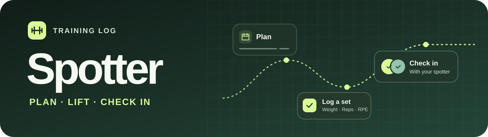

<div align="center">



# Spotter

**A mobile-first workout log for training partners. Plan your sessions, record every set, and check in together.**

[Try the web app](https://spotter-free.couple-ledger-service.workers.dev) · [Features](#features) · [Quick start](#quick-start) · [Self-hosting](#self-hosting) · [简体中文](README.md)

</div>

## Why Spotter

Your plan is on the calendar, your weights are in a notes app, and your partner still needs a message after the workout. Spotter puts all three in one flow. Open today's session, log the weight and reps you actually completed, then check in so your partner can follow along. You can also start an empty workout and build it as you go.

Open the online preview in a browser to explore sample data. Sign in to save your own records, or run the standalone edition on your server. [Try the web app](https://spotter-free.couple-ledger-service.workers.dev)

## Features

### Planning and training

- **Follow a plan or start on the spot.** Import text, plan JSON, or a follow-along video. Schedule recurring sessions from personal templates, or start an empty workout and add exercises from the catalogue.
- **Log each set as you complete it.** Record weight, reps, time, left and right sides, warm-up sets, drop sets, and effort. Use a rest timer and pick up a saved draft later.
- **Use your history for the next session.** Review volume, sessions, duration, the activity calendar, and muscle distribution. Check exercise history and get suggested loads for an upcoming set or session based on completed sets.

### Training partners and sharing

- **Pair by invitation.** See your check-ins and your partner's in one calendar. Open a check-in for its details and cheer each other on.
- **Share by relationship.** Partners, friends, and coaches have separate relationships. Meal sharing has its own setting. A trainee can review and accept plans sent by their coach before those plans enter the calendar.
- **Keep your work when the gym loses signal.** The Cloudflare and Sites editions queue workout check-ins and sync them when the connection returns.

### Nutrition and AI

- **Log meals, water, and body weight.** Use saved foods to calculate nutrition by portion, or identify a meal from a photo. Save your scoop weight, cup size, and mixer to log the nutrition of a full protein shake.
- **Handle training tasks in chat.** The in-app coach can show training stats, record a weigh-in, and draft a plan. Revise a draft in chat and review it before adding it to the calendar.
- **Connect your own agent.** Authorized external tools can read training context, submit plan drafts, or add records. Model-backed features require server configuration. [Coach setup](cloudflare/docs/ai-coach.md) · [Agent access](cloudflare/docs/agent-api.md)

In the Sites edition, tell the coach “喝了蛋白粉” to log one shake from your saved recipe. A single product is picked automatically. If you have several, name the product in the message or choose one when the coach asks. See the table below for edition availability.

## Editions

| Edition | Where to find it | What it runs |
| --- | --- | --- |
| **Standalone Node** | Repository root, Next.js + SQLite | Self-host plan import, set logging, partner check-ins, training history, stats, and device-file import. |
| **Cloudflare** | [Try the web app](https://spotter-free.couple-ledger-service.workers.dev) · [Source](cloudflare/) | Workers + D1, with an exercise catalogue, multiweek programs, offline check-in sync, nutrition, and AI. Shares accounts and data with the default iPhone app configuration. |
| **Private Sites** | [Preview site](https://spotter-duo.stezero.chatgpt.site) · [Source branch](https://github.com/stevensun1005/spotter/tree/sites/source-2026-11-24) | An invite-only preview with Sites sign-in and a separate D1 database. Used to try new coach, partner, and workout features. |

Each deployment has its own accounts and storage. To move records, export them from the original instance and check the account when importing into the destination.

## Quick start

The following steps run the standalone Node edition from the repository root. Use **Node.js 24 or later**.

1. Clone the repository and install dependencies.

   ```sh
   git clone https://github.com/stevensun1005/spotter.git
   cd spotter
   npm ci
   ```

2. Copy [`.env.example`](.env.example) to `.env.local`. Generate a private setup code and set `SPOTTER_SETUP_CODE` to the output.

   ```sh
   node -e "console.log(require('node:crypto').randomBytes(16).toString('hex'))"
   ```

3. Run `npm run dev` and open [the local app](http://127.0.0.1:3000). Create the first account with the setup code, then generate an invite in the partner area.

<details>
<summary>Import plans from the command line</summary>

From an environment with access to the intended SQLite database, preview the dates, account, and number of new plans.

```sh
npm run plans:import -- --user your-login --dry-run plans.json
```

Remove `--dry-run` once the preview looks right. Identical plans are skipped. The default database path is `.data/spotter.sqlite` and can be set with `SPOTTER_DB_PATH`.

</details>

## Self-hosting

| Environment | Deployment |
| --- | --- |
| **Server with persistent storage** | Run `npm ci` and `npm run build` at the repository root. Set `SPOTTER_ORIGIN` to the HTTPS origin without a trailing slash, `SPOTTER_DB_PATH` to an absolute writable path on persistent storage, and `SPOTTER_SETUP_CODE` to a private setup code. Run `npm start` as a non-root service user, proxy HTTPS to `127.0.0.1:3000`, and back up SQLite regularly. |
| **Cloudflare Workers + D1** | Build [`cloudflare/`](cloudflare/), create a D1 database, apply migrations, and deploy. [Deployment steps](cloudflare/README.md#cloudflare-部署) · [Apple and Google sign-in](docs/cloudflare-login.md) |

## iPhone and health devices

- **iPhone development build.** Open `ios/SpotterHealth.xcodeproj` in Xcode on a Mac and select the **Spotter** scheme. It targets iOS 16 or later. The app loads the Cloudflare workout interface and has a native HealthKit module. Physical-device installation requires signing. [iPhone build and release guide](docs/iphone-app.md)
- **Health sync.** Native HealthKit pairing and sync use the standalone Node service's device endpoints. The data types depend on the permissions the user grants. [Health-device sync](docs/health-device-sync.md)
- **Heart-rate file import.** Import Apple Health ZIP/XML, Garmin FIT/TCX, WHOOP CSV/ZIP, or a generic CSV with `time,bpm` from a workout's detail page. Review the workout window and the matching samples before saving to your account. WHOOP summary sync is an optional integration.

## Development and documentation

| Task | Start here |
| --- | --- |
| Change a page or endpoint | [`app/`](app/) pages and routes · [`features/`](features/) domain logic · [`server/`](server/) accounts and storage |
| Work on Cloudflare or iPhone | [`cloudflare/`](cloudflare/) web app and Worker · [`ios/`](ios/) iPhone source |
| Configure AI or an external tool | [Plan assistant](cloudflare/docs/plan-assistant.md) · [AI coach](cloudflare/docs/ai-coach.md) · [Agent access](cloudflare/docs/agent-api.md) |
| Understand coaching and project workflows | [Coaches and trainees](cloudflare/docs/coaching.md) · [Project guide](AGENTS.md) |
| Get help with your account, privacy, or data exports | [Privacy notice](https://spotter-free.couple-ledger-service.workers.dev/privacy) · [Support](https://spotter-free.couple-ledger-service.workers.dev/support) |

```sh
npm run typecheck
npm run build
npm test
```

When reporting an issue or proposing a change, include the edition, reproduction steps, and what you verified. Use synthetic accounts in examples and keep personal workouts, health records, databases, and credentials out of Git.

## License and credits

Spotter's own code and documentation are licensed under the [MIT License](LICENSE). The openGym exercise catalogue, translations, and muscle data retain their applicable AGPL-3.0 and original-entry MIT terms. Body-map geometry, exercise media, and other third-party components retain their respective terms. See [Third-party notices](NOTICE.md). Thanks to the maintainers and contributors of [openGym](https://github.com/DuarteSantos8/openGym).
