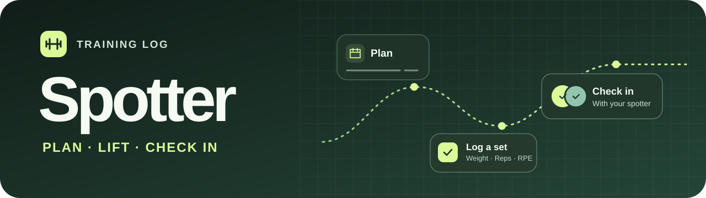

<div align="center">



# 训练搭子 · Spotter

**手机优先的训练记录和搭子打卡工具。排计划、逐组记训练，练完互相看进度。**

[体验网页](https://spotter-free.couple-ledger-service.workers.dev) · [主要功能](#主要功能) · [快速开始](#快速开始) · [自行部署](#自行部署) · [English](README.en.md)

</div>

## 为什么做训练搭子

计划在日历里，实际重量在备忘录里，练完还要给搭子发消息。在 Spotter 打开今天的训练，记下每一组实际完成的重量和次数，完成后就能和搭子互看打卡。临时想练也可以从空白训练开始。

在浏览器可以先看示例数据。登录后，Cloudflare 网页和 iPhone App 可用同一个账号保存和同步记录。[体验网页](https://spotter-free.couple-ledger-service.workers.dev)

## 主要功能

### 计划和训练

- **按计划练，也可以临时开练。** 导入文字、计划 JSON 或跟练视频。用个人模板安排重复训练，或开一堂空白训练，再从动作库添加动作。
- **记实际完成的每一组。** 重量、次数、时长、左右侧、热身组、递减组和主观用力程度都有各自的记录项。训练页支持休息计时和恢复草稿。
- **用历史规划下一次。** 查看训练容量、次数、时长、活跃日历和肌群分布。查看动作历史，按完成记录获得下一组或下一次的负重建议。

### 搭子和分享

- **用邀请码配对。** 在同一日历里看自己和搭子的训练打卡，点记录进入详情，练完可以互相加油。
- **按关系分享。** 搭子、普通好友和教练分别管理。饮食分享有独立开关，教练下发的计划需要学员确认后进入日程。
- **保留断网时的训练记录。** 网页和 iPhone App 可暂存打卡，恢复联网后同步。

### 饮食和 AI

- **记餐、喝水和体重。** 从食物库选食物并按份量计算营养，也可以拍照识别餐食。蛋白粉仓库保存每勺粉量、杯量和冲泡材料，按整杯配方记入饮食。
- **在对话里处理训练。** 站内 AI 教练可以查训练统计、记体重、起草计划。草稿可继续在聊天里改，核对后再加到日程。
- **让自己的 Agent 接入。** 外部工具可以持本人授权，读取训练上下文、提交计划草稿或添加记录。模型功能需要服务端配置。[AI 教练配置](cloudflare/docs/ai-coach.md) · [Agent 接入](cloudflare/docs/agent-api.md)

## 运行方式

| 版本 | 入口 | 适合做什么 |
| --- | --- | --- |
| **Cloudflare 网页** | [体验网页](https://spotter-free.couple-ledger-service.workers.dev) · [源码](cloudflare/) | Workers + D1，运行网页和供 iPhone 使用的 API。 |
| **iPhone 与 Apple Watch** | [原生源码](ios/) · [安装与发布](docs/iphone-app.md) | SwiftUI 训练界面、Apple 健康、手表训练和小组件。默认连接同一个 Cloudflare 服务。 |

本地、测试与正式服务使用各自的账号和 D1 数据库。迁移记录时从源环境导出，再核对目标账号后导入。

## 快速开始

使用 **Node.js 24 或更新版本**。依赖和本地数据库配置位于 `cloudflare/`。

```sh
git clone https://github.com/stevensun1005/spotter.git
cd spotter/cloudflare
npm ci
npm run dev
```

打开终端显示的本地地址。需要保存记录时，先应用本地 D1 迁移，再使用合成账号登录。[本地 D1 和登录](cloudflare/README.md#本地-d1-与登录)

## 自行部署

在 `cloudflare/` 构建后，为自己的 Cloudflare 账号准备 D1，应用迁移并部署 Worker。原生 App 开发版可以配置相应的 HTTPS API 地址。[部署步骤](cloudflare/README.md#cloudflare-部署) · [Apple、Google 登录配置](docs/cloudflare-login.md)

## iPhone 和健康设备

- **iPhone 原生 App。** 在 Mac 的 Xcode 打开 `ios/SpotterHealth.xcodeproj`，选择 **Spotter** scheme，目标为 iOS 16 或更新版本。SwiftUI 训练界面直接调用 Cloudflare API，并使用系统登录、相机、Charts 和 HealthKit。真机安装需要签名。[iPhone App 构建与发布](docs/iphone-app.md)
- **健康同步。** iPhone 根据 Apple 健康授权读取样本，可将相符训练的心率和所选身体指标同步到当前 Cloudflare 账号。[健康设备同步](docs/health-device-sync.md)
- **从文件导入心率。** 在训练详情导入 Apple 健康 ZIP/XML、Garmin FIT/TCX、WHOOP CSV/ZIP，或包含 `time,bpm` 的通用 CSV。核对训练时段与样本后，将结果保存到本人账号。WHOOP 汇总同步也可单独配置。

## 开发与文档

| 想做什么 | 从这里开始 |
| --- | --- |
| 改网页或接口 | [`cloudflare/app/`](cloudflare/app/) 页面和路由 · [`cloudflare/features/`](cloudflare/features/) 业务逻辑 · [`cloudflare/server/`](cloudflare/server/) 账号和存储 |
| 改 iPhone 或 Apple Watch | [`ios/`](ios/) 原生源码 · [设计与入口](docs/product-design.md) |
| 配 AI 或外部工具 | [计划助手](cloudflare/docs/plan-assistant.md) · [AI 教练](cloudflare/docs/ai-coach.md) · [Agent 接入](cloudflare/docs/agent-api.md) |
| 了解分享与教练机制 | [教练与学员](cloudflare/docs/coaching.md) · [项目约定](AGENTS.md) |
| 查账号、隐私和数据导出 | [隐私说明](https://spotter-free.couple-ledger-service.workers.dev/privacy) · [使用支持](https://spotter-free.couple-ledger-service.workers.dev/support) |

```sh
npm run typecheck
npm run build
npm test
npm run test:ios-app
```

前 3 条命令可在仓库根目录运行。原生冒烟检查需要 Mac 和 Swift 工具链。提交问题时注明版本、复现步骤和验证结果。测试使用合成账号，个人训练、健康记录、数据库与密钥留在 Git 之外。

## 许可证与致谢

Spotter 自有代码和文档使用 [MIT 许可证](LICENSE)。openGym 的动作目录、翻译及肌肉数据保留其适用的 AGPL-3.0 和原始条目的 MIT 许可。人体图、动作媒体与其他第三方组件沿用各自条款，完整入口见[第三方声明](NOTICE.md)。感谢 [openGym](https://github.com/DuarteSantos8/openGym) 的维护者与贡献者。
